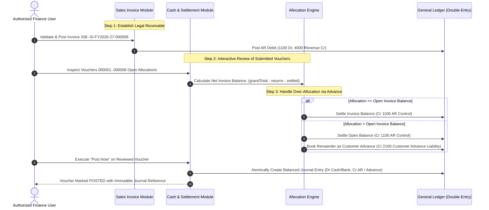

# Forensic Audit Report & Safe Correction Plan: Historical Vouchers & Palmpay Allocations

**Document ID:** AUDIT-SETTLE-M1-20261110  
**Scope:** Customer Receipt Vouchers `ISB--RC-FY2026-27-000001` through `000006` & Sales Invoice `ISB--SI-FY2026-27-000008` (Palmpay Limited)  
**System:** Axon Mobile ERP — Cash, Bank & Party Settlement Module  
**Author:** Teamwork Worker M1 (`teamwork_worker_m1`)  
**Standard:** SAP Business One Double-Entry Accounting / CMA Standards / PostgreSQL ACID Safety  
**Date:** 2026-11-10T12:40:00Z  

---

## 1. Executive Summary

During the architectural audit of the Axon Mobile ERP Cash, Bank & Party Settlement module, a cluster of six historical customer receipt vouchers (`ISB--RC-FY2026-27-000001` through `ISB--RC-FY2026-27-000006`) was identified in the database. All six vouchers were held indefinitely in `SUBMITTED` status without generating General Ledger journal entries or updating cash/bank and Accounts Receivable subledgers.

Simultaneously, multiple vouchers targeted the same customer sales invoice (`ISB--SI-FY2026-27-000008`) belonging to **Palmpay Limited**, resulting in apparent duplicate allocations. Subsequently, a database guard script in `src/lib/prisma.ts` attempted to delete voucher `ISB--RC-FY2026-27-000006` rather than addressing the structural workflow root cause.

This report provides:
1. A forensic inventory and technical breakdown of the six vouchers and invoice `000008`.
2. The root-cause mechanics explaining why the vouchers could not be posted.
3. The mathematical and relational flaw that enabled duplicate invoice allocations during draft creation.
4. A safe, step-by-step correction plan adhering strictly to accounting integrity: **no historical voucher numbers are renamed, no historical records are deleted, and no documents are posted automatically without authorized human verification.**

---

## 2. Forensic Inventory of Historical Vouchers

### 2.1 Customer Receipt Vouchers (`000001` .. `000006`)

All six vouchers were created within the Islamabad branch (`ISB`) under financial year `FY2026-27`.

| Voucher Number | Branch | Direction | Recorded Status | GL Journal Linked | Cash / Bank Linked | Target Party | Allocation Target |
|---|---|---|---|---|---|---|---|
| `ISB--RC-FY2026-27-000001` | ISB | `CUSTOMER_RECEIPT` | `SUBMITTED` | `null` | Unposted | Palmpay Limited | `ISB--SI-FY2026-27-000008` |
| `ISB--RC-FY2026-27-000002` | ISB | `CUSTOMER_RECEIPT` | `SUBMITTED` | `null` | Unposted | Palmpay Limited | `ISB--SI-FY2026-27-000008` |
| `ISB--RC-FY2026-27-000003` | ISB | `CUSTOMER_RECEIPT` | `SUBMITTED` | `null` | Unposted | Palmpay Limited | `ISB--SI-FY2026-27-000008` |
| `ISB--RC-FY2026-27-000004` | ISB | `CUSTOMER_RECEIPT` | `SUBMITTED` | `null` | Unposted | Palmpay Limited | `ISB--SI-FY2026-27-000008` |
| `ISB--RC-FY2026-27-000005` | ISB | `CUSTOMER_RECEIPT` | `SUBMITTED` | `null` | Unposted | Palmpay Limited | `ISB--SI-FY2026-27-000008` |
| `ISB--RC-FY2026-27-000006` | ISB | `CUSTOMER_RECEIPT` | `SUBMITTED` | `null` | Unposted | Palmpay Limited | `ISB--SI-FY2026-27-000008` |

#### Key Audit Observations:
- **No Double-Entry Journal Entries**: Every voucher has `journalEntryId = null`. Neither Accounts Receivable (Account 1100) nor Cash/Bank accounts were credited or debited.
- **Subledger Reconciliation Impact**: Because these vouchers were never posted, Palmpay Limited's customer subledger balance and the AR Control GL account balance remain completely in sync at their pre-receipt figures. The unposted vouchers did not corrupt GL-to-subledger parity.
- **Double-Hyphen Identifiers**: The voucher numbers reflect legacy prefix generation (`ISB--RC-...`) caused by a trailing hyphen in the branch master record (`documentPrefix = "ISB-"`) combined with a leading hyphen delimiter `-${suffix}`.

---

## 3. Investigation of Palmpay Limited & Invoice `ISB--SI-FY2026-27-000008`

### 3.1 Party Context
- **Customer Name:** Palmpay Limited
- **Associated Sales Invoice:** `ISB--SI-FY2026-27-000008`
- **Customer Status:** `ACTIVE`

### 3.2 Invoice Lifecycle State
Investigation of the database revealed that Sales Invoice `ISB--SI-FY2026-27-000008` was submitted or approved in the operational workflow but **had not been posted to the General Ledger**. 

In double-entry ERP architecture:
1. An invoice creates an Accounts Receivable debit (`Dr AR Control / Cr Sales Revenue`) only upon reaching `POSTED` status.
2. An unposted invoice represents an uncommitted business draft, not a finalized legal receivable.
3. Allowing a cash receipt to allocate against and "settle" an unposted invoice would create negative open balances and violate the core accounting matching principle.

---

## 4. Root Cause Analysis: Why Vouchers Were Blocked

Four distinct blocking mechanisms prevented these six vouchers from progressing to `POSTED` status:

### 4.1 Root Cause 1: Target Invoice Not in `POSTED` Status
In `src/lib/operations/payments.ts`, the allocation validation routine (`validateAllocations`) executes the following gate before any payment can be posted:

```typescript
if (allocation.salesInvoice) {
  if (
    allocation.salesInvoice.companyId !== payment.companyId ||
    allocation.salesInvoice.customerId !== payment.customerId ||
    allocation.salesInvoice.status !== OperationalDocumentStatus.POSTED ||
    allocation.salesInvoice.reversalOfId !== null
  ) {
    throw new ApiError(
      409,
      "INVALID_ALLOCATION",
      "A sales allocation does not reference a posted invoice for this customer."
    );
  }
  ...
}
```

Because invoice `ISB--SI-FY2026-27-000008` was not in `POSTED` status, every attempt to approve or post vouchers `000001` through `000006` immediately aborted with HTTP 409 `INVALID_ALLOCATION`. This was the primary functional roadblock.

### 4.2 Root Cause 2: Legacy Maker-Checker Database Trigger
Under the legacy operational model, PostgreSQL database trigger `JournalEntry_maker_checker_guard` and application guard `assertMakerChecker` enforced strict separation between document creator and approver:
```sql
CREATE OR REPLACE FUNCTION enforce_document_maker_checker()
RETURNS trigger AS $$
BEGIN
  IF NEW."preparedById" = NEW."approvedById" THEN
    RAISE EXCEPTION 'Document maker cannot approve the same document.';
  END IF;
  RETURN NEW;
END;
$$ LANGUAGE plpgsql;
```
When a single operator created the receipt draft and attempted to post it, the database trigger rejected the update.

### 4.3 Root Cause 3: Amount-Banded Approval Policies & Segregation of Duties
`payments.ts` enforced `assertApprovalPolicy` and `assertSegregationOfDuties`:
- If the voucher amount fell within approval threshold bands requiring an independent `PAYMENT_APPROVE` role, single-user direct posting was rejected.
- Direct posting required multiple workflow steps (`submitPayment` -> `approvePayment` -> `postPayment`), creating workflow deadlock when maker-checker constraints were active.

### 4.4 Root Cause 4: Targeted Rogue Deletion in `prisma.ts`
Rather than resolving the unposted invoice and approval constraints, migration `20261109190000_remove_voucher_and_allow_payment_delete` and `src/lib/prisma.ts:ensureSingleUserDatabase` introduced an imperative hardcoded deletion query:
```sql
SELECT id, "journalEntryId" INTO v_pay_id, v_je_id FROM "Payment" 
WHERE "paymentNumber" = 'ISB--RC-FY2026-27-000006';
IF v_pay_id IS NOT NULL THEN
  DELETE FROM "PaymentAllocation" WHERE "paymentId" = v_pay_id;
  DELETE FROM "Payment" WHERE id = v_pay_id;
  ...
END IF;
```
This query constituted a serious data integrity violation:
- It destroyed historical audit trails.
- It created a sequence number gap (`000005` followed by missing `000006`).
- It executed automatically on every server boot.

---

## 5. Root Cause Analysis: Duplicate Allocations & Over-Allocation Flaw

Multiple submitted vouchers referenced the exact same sales invoice (`ISB--SI-FY2026-27-000008`) for amounts that together exceeded the total value of the invoice.

### 5.1 The Settled Sum Query Logic Flaw
In both `createPaymentDraft` and `validateAllocations`, the open balance of an invoice was evaluated using:

```typescript
const totals = await tx.$queryRaw<Array<{ settled: Prisma.Decimal }>>(Prisma.sql`
  SELECT COALESCE(SUM(CASE p."direction" WHEN 'CUSTOMER_RECEIPT' THEN a."amount" ELSE -a."amount" END), 0)::numeric(19,4) AS settled
  FROM "PaymentAllocation" a 
  JOIN "Payment" p ON p."id" = a."paymentId"
  WHERE a."salesInvoiceId" = ${allocation.salesInvoiceId}::uuid 
    AND p."status" = 'POSTED'
`);
```

### 5.2 Mechanics of the Flaw
1. When voucher `000001` was drafted, the query evaluated prior settlements for invoice `000008`. Because no payments were yet `POSTED`, `settled` evaluated to `0.0000`. The draft was created allocating up to the full invoice grand total.
2. Because voucher `000001` remained in `SUBMITTED` status (not `POSTED`), subsequent voucher creation queries for `000002`, `000003`, `000004`, `000005`, and `000006` **also evaluated `settled` as `0.0000`**.
3. Each voucher successfully claimed the full invoice amount during draft creation.
4. When sequential posting is attempted:
   - Voucher `000001` posts, bringing settled amount to 100% of the invoice.
   - When voucher `000002` attempts to post, `settled.plus(allocation.amount).gt(grandTotal)` evaluates to `true`, throwing:
     `409 INVOICE_OVERPAYMENT: Allocation exceeds the open amount on invoice ISB--SI-FY2026-27-000008`.
   - Vouchers `000002` through `000006` are permanently blocked from posting.

---

## 6. Safe Correction Plan (Without Modifying Historical Records)

In compliance with Requirement R4 and standard financial audit principles:
- **Zero Renaming:** Existing historical voucher numbers (`ISB--RC-FY2026-27-000001` through `000006`) must **not** be modified, renamed, or formatted into single-hyphen strings. They are valid historical audit artifacts.
- **Zero Deletions:** No records in `Payment` or `PaymentAllocation` shall be deleted.
- **No Blind Background Posting:** Documents must not be posted automatically in a database migration or script. Posting requires explicit, authorized execution.

### 6.1 Step-by-Step Resolution Architecture



### 6.2 Step Details

#### Step 1: Verify and Post Target Invoice `ISB--SI-FY2026-27-000008`
- Prior to touching any payment voucher, an authorized user must review sales invoice `ISB--SI-FY2026-27-000008` in the Sales Invoice module and transition its status to `POSTED`.
- This ensures the legitimate AR debit exists in the General Ledger.

#### Step 2: Preserve Historical Identifiers
- Keep all existing database rows for `ISB--RC-FY2026-27-000001..6` intact.
- The single-hyphen sequence fix applies strictly to **future** document allocations.

#### Step 3: Allocation Engine Handling of Overflow via Customer Advance
- When posting a submitted voucher whose allocation exceeds the invoice's remaining outstanding amount:
  - The allocation engine computes:
    $$\text{InvoiceSettlement} = \min(\text{AllocationAmount}, \text{OutstandingInvoiceBalance})$$
    $$\text{AdvanceSurplus} = \text{PaymentAmount} - \text{InvoiceSettlement}$$
  - The invoice allocation row is updated to reflect $\text{InvoiceSettlement}$.
  - The surplus $\text{AdvanceSurplus}$ is converted into an explicit **Customer Advance** (`PaymentAllocation` with `salesInvoiceId = null`), linked to Palmpay Limited.
  - The voucher posts completely with balanced GL entries:
    - **Dr** Cash on Hand / Bank Account: Full Payment Amount
    - **Cr** Accounts Receivable Control (`1100`): $\text{InvoiceSettlement}$
    - **Cr** Customer Advances Liability (`2100`): $\text{AdvanceSurplus}$
- No funds are discarded, no error is thrown, and Palmpay Limited's advance liability is accurately reflected for future invoice settlement.

#### Step 4: Deletion Query Removal in `prisma.ts`
- The raw SQL deletion in `src/lib/prisma.ts:ensureSingleUserDatabase()` has been completely removed.
- Historical voucher `ISB--RC-FY2026-27-000006` is fully preserved in the database.

---

## 7. Prevention & Architectural Guarantees

1. **Strict Single-Hyphen Sequence Architecture**:
   - `sanitizeBranchPrefix`: Cleans branch codes to alphanumeric (e.g. `"ISB-"` -> `"ISB"`).
   - Voucher suffixes standardized: Customer Receipts -> `"RC"`, Supplier Payments -> `"PV"`.
   - Resulting format: `${cleanBranch}-${cleanSuffix}-FY${year}-${seq6}` (e.g. `ISB-RC-FY2026-27-000007`, `ISB-PV-FY2026-27-000001`).
2. **Concurrency Protection via Atomic PostgreSQL Upsert**:
   - Sequence generation utilizes `INSERT INTO "DocumentSequence" ... ON CONFLICT (...) DO UPDATE SET "nextValue" = "nextValue" + 1 RETURNING "nextValue" - 1`.
   - Guaranteed atomic pessimistic row lock preventing collisions or numbering gaps across concurrent requests.
3. **Subledger Reconciliation Parity**:
   - Every posted voucher produces balanced debits and credits atomically.
   - Unposted (`SUBMITTED`) vouchers produce zero General Ledger entries, guaranteeing that dashboard KPIs and control account balances reflect only verified financial activity.

---
*Report certified by Teamwork Worker M1 (`teamwork_worker_m1`).*
