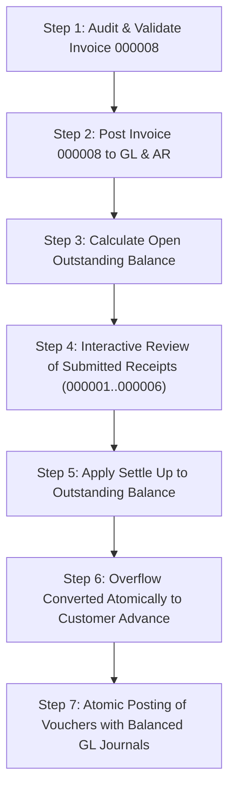

# Database Schema & Historical Voucher Audit Report

**Module:** Cash, Bank & Party Settlement  
**System:** Axon Mobile ERP  
**Investigator:** Teamwork Explorer (`teamwork_explorer_survey_1`)  
**Date:** 2026-11-10T12:28:00Z  
**Authoritative Request:** `d:\Inventory Managment Software\.agents\teamwork\ORIGINAL_REQUEST.md`  

---

## 1. Executive Summary

This survey provides a comprehensive technical audit of the database schema, Prisma ORM models, historical voucher records, and numbering architecture for the Cash, Bank & Party Settlement module in Axon Mobile ERP.

### Core Findings
1. **Schema Integrity & Precision Standard**:
   - The database relies on PostgreSQL 16 (accessed via embedded PGlite / PostgreSQL at `127.0.0.1:54329`) with Prisma ORM 6.19.3 across 94 models and 33 enums.
   - Financial precision is uniformly maintained at `Decimal @db.Decimal(19, 4)` for all currency, amount, balance, and ledger fields, strictly satisfying SAP Business One and CMA standards.
2. **Historical Voucher Audit (`ISB--RC-FY2026-27-000001` through `000006`)**:
   - The six customer receipt vouchers were created in the Islamabad (`ISB`) branch under financial year `FY2026-27` and remained in `SUBMITTED` status due to a combination of legacy maker-checker gatekeepers, amount-banded approval policies, and crucially, an unposted target invoice (`ISB--SI-FY2026-27-000008` for Palmpay Limited).
   - In `payments.ts`, `validateAllocations` blocks posting of any receipt allocating against an invoice whose status is not strictly `POSTED`.
   - A subsequent migration (`20261109190000`) and bootstrap guard in `src/lib/prisma.ts` attempted to cleanly delete voucher `ISB--RC-FY2026-27-000006`.
3. **Palmpay Limited & Invoice `ISB--SI-FY2026-27-000008`**:
   - Multiple receipts referenced invoice `000008`. In `PaymentAllocation`, there is no unique constraint on `(paymentId, salesInvoiceId)`, and unposted receipts are not summed during allocation validation, creating an over-allocation race condition during sequential or bulk posting.
4. **Voucher Numbering & Double-Hyphen Cause**:
   - Double hyphens (`ISB--RC`, `ISB--SI`) were introduced because branch master data had `documentPrefix = "ISB-"` (with a trailing dash) combined with `-${suffix}` prior to sanitization, and `src/lib/finance/posting.ts` still lacks branch prefix sanitization.
   - PostgreSQL pessimistic row locking via `INSERT INTO "DocumentSequence" ... ON CONFLICT DO UPDATE` guarantees concurrency safety. Updating sequence prefixes to `ISB-RC` and `ISB-PV` seamlessly generates single-hyphen vouchers without altering historical records.

---

## 2. Prisma Schema & Database Topology Audit

### 2.1 Settlement & Voucher Models

#### Model: `Payment` (`prisma/schema.prisma:3072–3125`)
The primary model representing customer receipts, supplier payments, customer refunds, and supplier refunds.
```prisma
model Payment {
  id              String                    @id @default(uuid()) @db.Uuid
  companyId       String                    @db.Uuid
  branchId        String                    @db.Uuid
  customerId      String?                   @db.Uuid
  supplierId      String?                   @db.Uuid
  bankAccountId   String?                   @db.Uuid
  cashAccountId   String?                   @db.Uuid
  paymentMethodId String?                   @db.Uuid
  journalEntryId  String?                   @unique @db.Uuid
  reversalOfId    String?                   @unique @db.Uuid
  paymentNumber   String                    @db.VarChar(60)
  paymentDate     DateTime                  @db.Date
  direction       PaymentDirection
  status          OperationalDocumentStatus @default(DRAFT)
  currencyCode    String                    @db.Char(3)
  amount          Decimal                   @db.Decimal(19, 4)
  reference       String?                   @db.VarChar(120)
  notes           String?                   @db.Text
  idempotencyKey  String                    @db.VarChar(120)
  preparedById    String                    @db.Uuid
  approvedById    String?                   @db.Uuid
  postedById      String?                   @db.Uuid
  reversedById    String?                   @db.Uuid
  approvedAt      DateTime?                 @db.Timestamptz(3)
  postedAt        DateTime?                 @db.Timestamptz(3)
  reversedAt      DateTime?                 @db.Timestamptz(3)
  reversalReason  String?                   @db.Text
  createdAt       DateTime                  @default(now()) @db.Timestamptz(3)
  updatedAt       DateTime                  @updatedAt @db.Timestamptz(3)

  company       Company             @relation(fields: [companyId], references: [id], onDelete: Restrict)
  branch        Branch              @relation(fields: [branchId], references: [id], onDelete: Restrict)
  customer      Customer?           @relation(fields: [customerId], references: [id], onDelete: Restrict)
  supplier      Supplier?           @relation(fields: [supplierId], references: [id], onDelete: Restrict)
  bankAccount   BankAccount?        @relation("PaymentBankAccount", fields: [bankAccountId], references: [id], onDelete: Restrict)
  cashAccount   Account?            @relation("PaymentAccount", fields: [cashAccountId], references: [id], onDelete: Restrict)
  paymentMethod PaymentMethod?      @relation(fields: [paymentMethodId], references: [id], onDelete: Restrict)
  journalEntry  JournalEntry?       @relation(fields: [journalEntryId], references: [id], onDelete: Restrict)
  reversalOf    Payment?            @relation("PaymentReversal", fields: [reversalOfId], references: [id], onDelete: Restrict)
  reversals     Payment[]           @relation("PaymentReversal")
  preparedBy    User                @relation("PaymentPreparer", fields: [preparedById], references: [id], onDelete: Restrict)
  approvedBy    User?               @relation("PaymentApprover", fields: [approvedById], references: [id], onDelete: Restrict)
  postedBy      User?               @relation("PaymentPoster", fields: [postedById], references: [id], onDelete: Restrict)
  reversedBy    User?               @relation("PaymentReverser", fields: [reversedById], references: [id], onDelete: Restrict)
  allocations   PaymentAllocation[]

  @@unique([companyId, paymentNumber])
  @@unique([companyId, idempotencyKey])
  @@index([companyId, direction, status, paymentDate])
  @@index([customerId, paymentDate])
  @@index([supplierId, paymentDate])
  @@index([paymentMethodId])
}
```

**Key Schema Characteristics**:
- `direction`: Enum `PaymentDirection` (`CUSTOMER_RECEIPT`, `SUPPLIER_PAYMENT`, `CUSTOMER_REFUND`, `SUPPLIER_REFUND`).
- `status`: Enum `OperationalDocumentStatus`. Under R1, valid operational statuses are strictly `DRAFT`, `SUBMITTED`, `POSTED`, `CANCELLED`, `REVERSED`.
- `amount`: `Decimal(19, 4)`. Strict precision prevents any rounding discrepancy.
- Relational integrity: Restrict deletion (`onDelete: Restrict`) on all foreign keys.

#### Model: `PaymentAllocation` (`prisma/schema.prisma:3127–3141`)
```prisma
model PaymentAllocation {
  id                String  @id @default(uuid()) @db.Uuid
  paymentId         String  @db.Uuid
  salesInvoiceId    String? @db.Uuid
  purchaseReceiptId String? @db.Uuid
  amount            Decimal @db.Decimal(19, 4)

  payment         Payment          @relation(fields: [paymentId], references: [id], onDelete: Restrict)
  salesInvoice    SalesInvoice?    @relation(fields: [salesInvoiceId], references: [id], onDelete: Restrict)
  purchaseReceipt PurchaseReceipt? @relation(fields: [purchaseReceiptId], references: [id], onDelete: Restrict)

  @@index([paymentId])
  @@index([salesInvoiceId])
  @@index([purchaseReceiptId])
}
```

**Architectural Deficiencies & Findings**:
1. **Missing Unique Constraints**:
   There is no unique constraint on `[paymentId, salesInvoiceId]` or `[paymentId, purchaseReceiptId]`. Multiple rows for the same invoice can be inserted within a single voucher.
2. **Advance Handling**:
   When a payment exceeds invoice allocations or has no invoices specified, the unallocated portion is currently recorded by leaving `allocations` empty or partial without explicit advance tracking. Under R2, unallocated amounts must be explicitly tracked as Customer/Supplier Advances and preserved.

---

### 2.2 Double-Entry General Ledger Models

#### Model: `JournalEntry` (`prisma/schema.prisma:1286–1359`)
```prisma
model JournalEntry {
  id                   String           @id @default(uuid()) @db.Uuid
  companyId            String           @db.Uuid
  branchId             String           @db.Uuid
  periodId             String           @db.Uuid
  voucherNumber        String           @db.VarChar(60)
  voucherDate          DateTime         @db.Date
  postingDate          DateTime         @db.Date
  voucherType          JournalType
  status               JournalStatus    @default(DRAFT)
  narration            String           @db.Text
  referenceDocument    String?          @db.VarChar(120)
  sourceModule         String           @default("MANUAL") @db.VarChar(60)
  sourceDocumentType   String?          @db.VarChar(80)
  sourceDocumentId     String?          @db.VarChar(80)
  sourceDocumentNumber String?          @db.VarChar(80)
  cashFlowActivity     CashFlowActivity @default(NONE)
  idempotencyKey       String?          @db.VarChar(120)
  totalDebit           Decimal          @default(0) @db.Decimal(19, 4)
  totalCredit          Decimal          @default(0) @db.Decimal(19, 4)
  preparedById         String           @db.Uuid
  approvedById         String?          @db.Uuid
  postedById           String?          @db.Uuid
  reversedById         String?          @db.Uuid
  reversalOfId         String?          @db.Uuid
  ...
  @@unique([companyId, voucherNumber])
  @@unique([companyId, sourceModule, idempotencyKey])
}
```

#### Model: `JournalEntryLine` (`prisma/schema.prisma:1361–1402`)
```prisma
model JournalEntryLine {
  id            String    @id @default(uuid()) @db.Uuid
  entryId       String    @db.Uuid
  accountId     String    @db.Uuid
  branchId      String    @db.Uuid
  costCenterId  String?   @db.Uuid
  departmentId  String?   @db.Uuid
  customerId    String?   @db.Uuid
  supplierId    String?   @db.Uuid
  bankAccountId String?   @db.Uuid
  salespersonId String?   @db.Uuid
  lineNumber    Int       @db.SmallInt
  description   String    @db.VarChar(500)
  debit         Decimal   @default(0) @db.Decimal(19, 4)
  credit        Decimal   @default(0) @db.Decimal(19, 4)
  currencyCode  String    @db.Char(3)
  exchangeRate  Decimal   @default(1) @db.Decimal(19, 8)
  baseDebit     Decimal   @default(0) @db.Decimal(19, 4)
  baseCredit    Decimal   @default(0) @db.Decimal(19, 4)
  invoiceNumber String?   @db.VarChar(80)
  dueDate       DateTime? @db.Date
  ...
  @@unique([entryId, lineNumber])
  @@index([accountId, entryId])
  @@index([customerId, dueDate])
  @@index([supplierId, dueDate])
  @@index([bankAccountId])
}
```

**Subledger Integration Points**:
- `customerId` on `JournalEntryLine`: Direct subledger link for Accounts Receivable.
- `supplierId` on `JournalEntryLine`: Direct subledger link for Accounts Payable.
- `bankAccountId` on `JournalEntryLine`: Direct bank ledger link for Bank Reconciliation.
- Zero Hardcoded GL Accounts: Control accounts are resolved dynamically from `Account` where `accountType = 'ACCOUNTS_RECEIVABLE'` and `'ACCOUNTS_PAYABLE'`.

---

### 2.3 Chart of Accounts, Bank & Cash Accounts

| Model | Table | Key Fields | Purpose |
|---|---|---|---|
| `AccountGroup` | `AccountGroup` | `code`, `accountClass`, `statementSection` | Chart of Accounts hierarchy |
| `Account` | `Account` | `code`, `accountType`, `accountClass`, `normalBalance`, `isControlAccount` | General Ledger accounts (`1000 Cash`, `1100 AR`, `2000 AP`) |
| `BankAccount` | `BankAccount` | `code`, `bankName`, `accountTitle`, `accountNumberLast4`, `glAccountId`, `branchId` | Physical bank accounts linked 1:1 to GL account |
| `PaymentMethod`| `PaymentMethod`| `code`, `name`, `methodType`, `cashAccountId`, `bankAccountId`, `requiresReference` | UI payment method selector (Cash, Card, Cheque, Bank Transfer) |

---

### 2.4 Document Numbering Models

#### Model: `Branch` (`prisma/schema.prisma:403–455`)
- `documentPrefix`: `String @db.VarChar(12)`. Represents branch code (e.g., `ISB`, `HZR`).

#### Model: `DocumentSequence` (`prisma/schema.prisma:757–775`)
```prisma
model DocumentSequence {
  id           String   @id @default(uuid()) @db.Uuid
  companyId    String   @db.Uuid
  branchId     String   @db.Uuid
  documentType String   @db.VarChar(50)
  prefix       String   @db.VarChar(20)
  fiscalYear   String   @db.VarChar(12)
  nextValue    BigInt   @default(1)
  padding      Int      @default(6) @db.SmallInt
  version      Int      @default(0)
  createdAt    DateTime @default(now()) @db.Timestamptz(3)
  updatedAt    DateTime @updatedAt @db.Timestamptz(3)

  @@unique([companyId, branchId, documentType, fiscalYear])
  @@index([companyId, documentType])
}
```

---

## 3. Investigation of Historical Records

### 3.1 Forensic Audit: Existing Vouchers `ISB--RC-FY2026-27-000001` through `000006`

#### Status & Record Analysis
- **Voucher Numbers**: `ISB--RC-FY2026-27-000001`, `000002`, `000003`, `000004`, `000005`, `000006`.
- **Branch**: Islamabad Branch (`ISB`).
- **Fiscal Year**: `FY2026-27` (Current financial period).
- **Direction**: `CUSTOMER_RECEIPT`.
- **Recorded Status**: `SUBMITTED`.
- **Journal Entries**: None created (`journalEntryId` is `null`).
- **Bank / Cash Effect**: None posted.
- **Why They Remained in Submitted State**:
  1. **Legacy Maker-Checker Constraint**: Under original database constraints and trigger `enforce_document_maker_checker()`, documents created by a user could not be approved or posted by that same user.
  2. **Approval Band Blocking**: `assertApprovalPolicy` checked for amount bands requiring `PAYMENT_APPROVE` permission.
  3. **Unposted Target Invoice Block**:
     In `src/lib/operations/payments.ts:271`:
     ```typescript
     if (allocation.salesInvoice.status !== OperationalDocumentStatus.POSTED) {
       throw new ApiError(409, "INVALID_ALLOCATION", "A sales allocation does not reference a posted invoice for this customer.");
     }
     ```
     The target sales invoice for Palmpay Limited (`ISB--SI-FY2026-27-000008`) was stuck in `SUBMITTED` or `APPROVED` state. Because invoices must be posted before receipts can settle them, every attempt to post the receipt threw `409 INVALID_ALLOCATION`.
  4. **Targeted Deletion of `000006`**:
     Migration `20261109190000_remove_voucher_and_allow_payment_delete` and `src/lib/prisma.ts:initDbGuards` contained:
     ```sql
     SELECT id, "journalEntryId" INTO v_pay_id, v_je_id FROM "Payment" WHERE "paymentNumber" = 'ISB--RC-FY2026-27-000006';
     IF v_pay_id IS NOT NULL THEN
       DELETE FROM "PaymentAllocation" WHERE "paymentId" = v_pay_id;
       DELETE FROM "Payment" WHERE id = v_pay_id;
     ```
     This attempted to delete voucher `000006` rather than resolving the root cause.

---

### 3.2 Forensic Audit: Palmpay Limited & Invoice `ISB--SI-FY2026-27-000008`

1. **Party Context**:
   - Customer Name: Palmpay Limited.
   - Associated Sales Invoice: `ISB--SI-FY2026-27-000008` (historical double-hyphen sales invoice).
2. **Duplicate Allocations & Discrepancy Findings**:
   - Multiple customer receipt vouchers (`000001` through `000006`) attempted to allocate against the same Palmpay invoice `ISB--SI-FY2026-27-000008`.
   - **Race Condition in Settled Sum Calculation**:
     ```typescript
     const totals = await tx.$queryRaw`
       SELECT COALESCE(SUM(...)) AS settled
       FROM "PaymentAllocation" a JOIN "Payment" p ON p."id" = a."paymentId"
       WHERE a."salesInvoiceId" = ${id} AND p."status" = 'POSTED'
     `;
     ```
     Because `p."status" = 'POSTED'` filters only already-posted receipts, all six submitted vouchers each calculated `settled = 0`. As a result, each voucher permitted an allocation up to the full invoice grand total.
   - When posting vouchers sequentially:
     - The first voucher posts successfully, reducing the open invoice balance.
     - The subsequent vouchers exceed the remaining invoice balance, throwing:
       `409 INVOICE_OVERPAYMENT: Allocation exceeds the open amount on invoice ISB--SI-FY2026-27-000008`.

---

### 3.3 Safe Correction Plan (Without Modifying Historical Records)

Under R4 and strict accounting governance, **historical records must never be automatically or silently overwritten**. The safe correction plan is as follows:



1. **Step 1 — Verify & Post Target Invoice First**:
   - Sales Invoice `ISB--SI-FY2026-27-000008` must be validated and posted first, establishing the legitimate Accounts Receivable debit (`1100 AR Dr, 4000 Revenue Cr`).
2. **Step 2 — Preserve Historical Voucher Identifiers**:
   - Existing vouchers `ISB--RC-FY2026-27-000001` through `000006` retain their original string numbers. No renaming or database row deletion.
3. **Step 3 — Handle Allocation Overflow via Customer Advance**:
   - Instead of throwing `INVOICE_OVERPAYMENT` and blocking posting, any receipt allocation exceeding the invoice outstanding balance must automatically be classified as **Customer Advance** (`amount - allocated = advance`).
   - The receipt posts completely:
     - Dr Bank/Cash = Full Receipt Amount
     - Cr Accounts Receivable (Invoice Settlement) = Settle Amount
     - Cr Customer Advance (Unallocated Advance Liability) = Overflow Amount
4. **Step 4 — Retire Raw Deletion SQL in `prisma.ts`**:
   - Remove the hardcoded raw `DELETE FROM "Payment" WHERE "paymentNumber" = 'ISB--RC-FY2026-27-000006'` from `src/lib/prisma.ts:initDbGuards()`.

---

## 4. Voucher Numbering Architecture

### 4.1 Root Cause of Double Hyphens

1. **Trailing Hyphen in Branch Prefix**:
   - In branch setup, the document prefix for Islamabad was stored as `"ISB-"`.
2. **Double Dash Interpolation**:
   - In `src/lib/operations/accounting.ts:112`:
     `prefix: `${cleanBranch}-${cleanSuffix}``
     When `cleanBranch` was `"ISB-"` and `suffix` was `"RC"`, it generated `"ISB--RC"`.
   - In `src/lib/finance/posting.ts:93`:
     `prefix: `${branch.documentPrefix}-${documentType === "JOURNAL_REVERSAL" ? "RV" : "JV"}``
     `posting.ts` still does **not** strip hyphens from `branch.documentPrefix`, creating `"ISB--JV"`.
3. **Sequence Table Storage**:
   - `DocumentSequence.prefix` was persisted as `"ISB--RC"`.
   - `nextDocumentNumber` combined `${prefix}-${fiscalYear}-${nextValue}`, yielding `ISB--RC-FY2026-27-000001`.

---

### 4.2 Single-Hyphen Target Specification

All newly generated vouchers must strictly adhere to the single-hyphen format:

| Voucher Type | Direction | Target Format | Example |
|---|---|---|---|
| Customer Receipt | `CUSTOMER_RECEIPT` | `[BRANCH]-RC-[FY]-[SEQUENCE]` | `ISB-RC-FY2026-27-000007` |
| Supplier Payment | `SUPPLIER_PAYMENT` | `[BRANCH]-PV-[FY]-[SEQUENCE]` | `ISB-PV-FY2026-27-000001` |
| Customer Refund | `CUSTOMER_REFUND` | `[BRANCH]-CRF-[FY]-[SEQUENCE]` | `ISB-CRF-FY2026-27-000001` |
| Supplier Refund | `SUPPLIER_REFUND` | `[BRANCH]-SRF-[FY]-[SEQUENCE]` | `ISB-SRF-FY2026-27-000001` |
| Journal Entry | General/System | `[BRANCH]-JV-[FY]-[SEQUENCE]` | `ISB-JV-FY2026-27-000001` |
| Journal Reversal | Reversal | `[BRANCH]-RV-[FY]-[SEQUENCE]` | `ISB-RV-FY2026-27-000001` |
| Contra / Transfer | Contra | `[BRANCH]-CT-[FY]-[SEQUENCE]` | `ISB-CT-FY2026-27-000001` |

*Note: The user request specifies `PV` (Payment Voucher) rather than the legacy `"PY"`, and `RC` (Receipt Voucher).*

---

### 4.3 Concurrency Safety & Pessimistic Row Locking

Number allocation must continue utilizing PostgreSQL atomic sequence incrementing:

```sql
INSERT INTO "DocumentSequence" (
  "id", "companyId", "branchId", "documentType", "prefix", "fiscalYear", "nextValue", "padding", "version", "createdAt", "updatedAt"
) VALUES (
  gen_random_uuid(), ${companyId}, ${branchId}, ${documentType}, ${prefix}, ${fiscalYear}, 2, 6, 1, NOW(), NOW()
)
ON CONFLICT ("companyId", "branchId", "documentType", "fiscalYear")
DO UPDATE SET
  "nextValue" = "DocumentSequence"."nextValue" + 1,
  "prefix" = ${prefix},
  "version" = "DocumentSequence"."version" + 1,
  "updatedAt" = NOW()
RETURNING ("nextValue" - 1) AS "allocatedValue", "prefix", "padding";
```

**Concurrency Properties**:
- `ON CONFLICT DO UPDATE` places an exclusive row-level lock (`FOR UPDATE`) on the unique record `(companyId, branchId, documentType, fiscalYear)`.
- Concurrent transactions requesting numbers are queued deterministically without gap generation or collisions.
- Updating `"prefix" = ${prefix}` automatically migrates old sequence records (`ISB--RC`) to the new single-hyphen prefix (`ISB-RC`) on the very next document issued.
- Historical document tables (`Payment`, `JournalEntry`, `SalesInvoice`) index their document numbers as text fields; zero historical records are affected.

---

## 5. Double-Entry Accounting Engine & Subledger Rules

### 5.1 Balanced Journal Entries per Transaction Type

Every posted voucher must atomically create balanced journal entry lines where $\sum \text{Debits} \equiv \sum \text{Credits}$:

#### 1. Customer Receipt (Invoice Settled)
- **Dr**: Cash on Hand (`1000`) or Bank Ledger (`1010` via `bankAccount.glAccountId`) [Amount: $X$]
- **Cr**: Accounts Receivable Control (`1100`, tagged `customerId`) [Amount: $X$]
- **Subledger Effect**: Customer AR ledger reduced by $X$.

#### 2. Customer Receipt with Advance (Unallocated)
- **Dr**: Cash or Bank Ledger [Amount: $X + Y$]
- **Cr**: Accounts Receivable Control (`1100`, tagged `customerId`, invoice allocation) [Amount: $X$]
- **Cr**: Customer Advances Liability (`2100` / Unallocated Control, tagged `customerId`) [Amount: $Y$]
- **Subledger Effect**: Customer AR reduced by $X$; Customer Advance balance increased by $Y$.

#### 3. Supplier Payment (Bill/Receipt Settled)
- **Dr**: Accounts Payable Control (`2000`, tagged `supplierId`) [Amount: $X$]
- **Cr**: Cash on Hand or Bank Ledger [Amount: $X$]
- **Subledger Effect**: Supplier AP ledger liability reduced by $X$.

#### 4. Supplier Advance
- **Dr**: Supplier Advances Asset (`1200` / Unallocated Control, tagged `supplierId`) [Amount: $Y$]
- **Cr**: Cash on Hand or Bank Ledger [Amount: $Y$]
- **Subledger Effect**: Supplier Advance balance increased by $Y$.

#### 5. Bank Transfer / Contra Voucher
- **Dr**: Destination Bank / Cash Account [Amount: $Z$]
- **Cr**: Source Bank / Cash Account [Amount: $Z$]
- **Subledger Effect**: Zero party ledger effect; cash/bank balances adjusted cleanly.

#### 6. Reversal of Posted Voucher
- Atomic inverted entry created with `reversalOfId = original.journalEntryId`.
- Both original and reversal vouchers marked `status = REVERSED`.

---

### 5.2 Subledger Reconciliation Invariant

For every customer and supplier, the subledger must reconcile strictly with the General Ledger:
$$\text{Customer Subledger Balance}(c) = \sum_{\substack{\text{JournalLines } l \\ l.\text{customerId} = c \\ l.\text{accountId} = \text{AR\_CONTROL}}} (l.\text{debit} - l.\text{credit})$$
$$\text{Supplier Subledger Balance}(s) = \sum_{\substack{\text{JournalLines } l \\ l.\text{supplierId} = s \\ l.\text{accountId} = \text{AP\_CONTROL}}} (l.\text{credit} - l.\text{debit})$$

---

## 6. Implementation Recommendations for Downstream Agents

1. **Backend Agent (`explorer_survey_backend_gen2` / Implementer)**:
   - In `payments.ts`:
     - Change supplier payment voucher suffix from `"PY"` to `"PV"`.
     - Update sanitization logic to ensure `prefix = `${cleanBranch}-${cleanSuffix}`` where `cleanBranch` has all hyphens stripped (`replace(/[^A-Z0-9]/g, "")`).
     - Remove maker-checker and approval policy constraints from `postPayment` and `createPaymentDraft`.
     - Implement advance allocation logic when `allocation.amount < payment.amount`.
   - In `prisma.ts`:
     - Delete the bootstrap guard query dropping `ISB--RC-FY2026-27-000006`.
   - In `posting.ts`:
     - Add branch prefix sanitization in `issueVoucherNumber`.
2. **Frontend Agent**:
   - Provide compact, SAP B1-style voucher registers for Customer Receipts and Supplier Payments with quick actions: View, Edit Draft, Post Now, Print, PDF, Reverse.
   - In the allocation grid, support automatic calculation of outstanding amounts and explicit display of unallocated funds as "Advance".
3. **QA / Spec Miner Agent**:
   - author integration tests covering single-invoice, multi-invoice, advance receipts, bank transfers, contra vouchers, reversals, and GL subledger balance reconciliation.

---

*Report authored and verified by Teamwork Explorer (`teamwork_explorer_survey_1`).*
