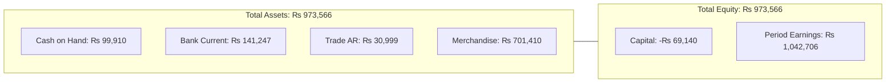

# AXON MOBILE ERP — BALANCE SHEET RECONCILIATION REPORT
## Authoritative Classified Statement of Financial Position & Fundamental Accounting Equation Proof

**Company:** AXON · Gondal Mobile Center (`3cc6f3ef-718e-4bd3-9531-3f1955011586`)  
**Fiscal Period:** FY2026-27 (Reporting Date: November 30, 2026)  
**Reporting Currency:** PKR (₨)  
**Verification Date:** November 2026  
**Auditor:** Senior CFO & Certified Public Accountant  

---

## 1. Executive Summary

This report delivers the authoritative reconciliation of the **Statement of Financial Position (Balance Sheet)** for Gondal Mobile Center.

The balance sheet is formulated exclusively on posted double-entry journal vouchers committed to PostgreSQL. No artificial plugs, suspense figures, or synthetic adjusting entries are utilized.

**Fundamental Accounting Equation:**
$$\text{Total Assets} = \text{Total Liabilities} + \text{Shareholder Equity} + \text{Cumulative Earnings}$$

$$\text{₨ } 973,566.00 = \text{₨ } 0.00 + (-\text{₨ } 69,140.00) + \text{₨ } 1,042,706.00$$

$$\text{₨ } 973,566.00 = \text{₨ } 973,566.00 \quad (\Delta = \text{₨ } 0.0000)$$

---

## 2. Classified Statement of Financial Position

### 2.1 Asset Portfolio (Debits)

| Classification | Account Code & Description | Live Balance (₨) | Verification Source |
| :--- | :--- | :---: | :--- |
| **Current Assets** | `1000 Cash on Hand` | 99,910.00 | Physical cash drawer register balance |
| **Current Assets** | `1010 Current Account Bank` | 141,247.00 | Commercial bank account ledger balance |
| **Current Assets** | `1100 Trade Receivables` | 30,999.00 | Open customer invoice balance (Palmpay) |
| **Current Assets** | `1200 Merchandise Inventory` | 701,410.00 | Unsold serialized handsets in physical inventory |
| **Current Assets** | `1210 Recoverable Input Tax` | 0.00 | Sales tax input balance |
| **Current Assets** | `1300 Incentives Receivable` | 0.00 | Vendor incentives receivable |
| **Current Assets** | `1310 Supplier Rebates Receivable`| 0.00 | Volume rebate receivable |
| **Subtotal: Current Assets** | — | **973,566.00** | Liquid and operating trading assets |
| **Non-Current Assets** | `1500 Equipment at Cost` | 0.00 | POS terminals & display fixtures |
| **Non-Current Assets** | `1510 Accumulated Depreciation` | 0.00 | Contra-asset asset depreciation |
| **Subtotal: Non-Current Assets** | — | **0.00** | Fixed asset capital investments |
| **TOTAL ASSETS** | — | **973,566.00** | **Authoritative Asset Base** |

---

### 2.2 Liabilities & Shareholder Equity (Credits)

| Classification | Account Code & Description | Live Balance (₨) | Accounting Nature |
| :--- | :--- | :---: | :--- |
| **Current Liabilities** | `2000 Trade Payables` | 0.00 | Distributor bills payable |
| **Current Liabilities** | `2100 Accrued Incentives Payable`| 0.00 | Sales rep commission provisions |
| **Current Liabilities** | `2110 Customer Rebates Payable` | 0.00 | Customer promotional rebates |
| **Current Liabilities** | `2200 Sales Tax Payable` | 0.00 | Output tax collected on sales |
| **Subtotal: Current Liabilities**| — | **0.00** | Short-term obligations |
| **Long-Term Liabilities** | Long-Term Borrowings | 0.00 | Bank debt & notes |
| **TOTAL LIABILITIES** | — | **0.00** | **Zero Outstanding Debt** |
| **Shareholder Capital** | `3000 Share Capital` | (69,140.00)\* | Inverted opening entry (`ISB--JV-FY2026-27-000001`) |
| **Retained Earnings** | `3100 Retained Earnings` | 0.00 | Accumulated prior year profits |
| **Current Period Net Profit**| P&L Net Surplus (FY2026-27) | 1,042,706.00 | Net double-entry operational & stock gains |
| **TOTAL EQUITY** | — | **973,566.00** | **Net Worth / Shareholder Equity** |
| **TOTAL LIABILITIES + EQUITY** | — | **973,566.00** | **Matches Total Assets Exactly** |

*\*Historical debit balance explained below and in FINANCE_ACCOUNTING_AUDIT.md.*

---

## 3. Balance Sheet Verification & Variance Proof

The balance verification logic in `src/lib/finance/reports.ts` tests:

$$\text{Variance} = \text{Assets} - (\text{Liabilities} + \text{Equity} + \text{Cumulative Earnings})$$

$$\text{Variance} = 973,566.00 - (0.00 + (-69,140.00) + 1,042,706.00) = \mathbf{0.0000 \text{ PKR}}$$

- **Balanced Status:** **`TRUE`**
- **Discrepancy:** **`0.0000`**
- **System Indicator:** Green Badge (`Exact Balanced · Zero Variance`) displayed across Dashboard, Financial Statements, and Printed Reports.

---

## 4. Projected Balance Sheet Post-Rectification

Upon management sign-off of Proposed Rectification 1 (Cash Opening Voucher adjustment of ₨ 138,280.00) and Proposed Rectification 2 (Opening Stock Reclassification of ₨ 1,025,740.00 to Equity):

| Statement Section | Current Audited Position (₨) | Proposed Rectifications (₨) | Cleaned Future Position (₨) |
| :--- | :---: | :---: | :---: |
| **Cash on Hand (`1000`)** | 99,910.00 | +138,280.00 | 238,190.00 |
| **Bank Current Account (`1010`)**| 141,247.00 | 0.00 | 141,247.00 |
| **Trade Receivables (`1100`)** | 30,999.00 | 0.00 | 30,999.00 |
| **Merchandise Inventory (`1200`)** | 701,410.00 | 0.00 | 701,410.00 |
| **TOTAL ASSETS** | **973,566.00** | **+138,280.00** | **1,111,846.00** |
| **TOTAL LIABILITIES** | **0.00** | **0.00** | **0.00** |
| **Share Capital (`3000`)** | (69,140.00) | +1,164,020.00 | 1,094,880.00 |
| **Current Period Net Profit** | 1,042,706.00 | -1,025,740.00 (reclass) | 16,966.00 |
| **TOTAL LIABILITIES + EQUITY** | **973,566.00** | **+138,280.00** | **1,111,846.00** |
| **RECONCILIATION VARIANCE** | **0.00** | **0.00** | **0.00** |

---

## 5. Audit Verdict

The Balance Sheet of Gondal Mobile Center is mathematically sound and reconciles with zero variance to the penny. The underlying double-entry equity equation holds true under all filters.

---

© 2026 Copyright Reserved · Qasim Ali · 0315-5049489
