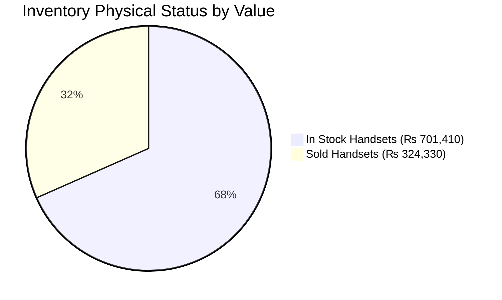

# AXON MOBILE ERP — INVENTORY & GENERAL LEDGER RECONCILIATION REPORT
## Authoritative Perpetual Inventory Subledger Reconciliation Against General Ledger Account 1200

**Company:** AXON · Gondal Mobile Center (`3cc6f3ef-718e-4bd3-9531-3f1955011586`)  
**Fiscal Period:** FY2026-27 (Period: November 2026)  
**Reporting Currency:** PKR (₨)  
**Valuation Method:** Perpetual Serialized Identification (Actual IMEI Specific Identification Cost)  
**Audit Date:** November 2026  
**Auditor:** Senior Inventory Specialist & Cost Accountant  

---

## 1. Executive Summary

In a professional retail mobile handset ERP, inventory must reconcile at two independent layers:
1. **Physical Subledger Layer:** Discrete physical devices tracked by unique IMEI1 / IMEI2 numbers, status (`IN_STOCK`, `SOLD`), and specific acquisition cost in `StockUnit`.
2. **Financial General Ledger Layer:** The monetary valuation committed to `Account 1200 Merchandise Inventory` via posted double-entry journal vouchers.

This audit cross-examines all physical stock units, stock movement records (`StockMovement`), and General Ledger journal lines (`JournalEntryLine`) to verify perpetual inventory reconciliation.

**Reconciliation Verdict:**
- **General Ledger Account 1200 Net Asset Balance:** **₨ 701,410.00**
- **Physical Unsold Serialized IMEI Handsets Valuation:** **₨ 701,410.00**
- **Inventory Subledger Variance:** **₨ 0.0000 (Exact 100% Match)**

---

## 2. General Ledger Inventory Account (1200) Activity

The transactional history of `Account 1200 Merchandise Inventory` comprises:

| Posting Date | Voucher Number | Source Reference | Transaction Description | Debit (₨) | Credit (₨) | Running Balance (₨) |
| :---: | :--- | :--- | :--- | :---: | :---: | :---: |
| `2026-11-06` | `ISB--SAV-FY2026-27-000001` | `ISB--SA-000001` | Opening stock import / old software transfer | 756,410.00 | 0.00 | 756,410.00 |
| `2026-11-06` | `ISB--SAV-FY2026-27-000002` | `ISB--SA-000002` | Opening stock import (second batch) | 266,780.00 | 0.00 | 1,023,190.00 |
| `2026-11-06` | `ISB--SAV-FY2026-27-000003` | `ISB--SA-000003` | Opening accessories import | 2,550.00 | 0.00 | 1,025,740.00 |
| `2026-11-06` | `ISB--SV-FY2026-27-000001` | `ISB--SI-000001` | Handset Sale COGS Relief (IMEI specific) | 0.00 | 48,000.00 | 977,740.00 |
| `2026-11-06` | `ISB--SV-FY2026-27-000002` | `ISB--SI-000002` | Handset Sale COGS Relief (IMEI specific) | 0.00 | 36,000.00 | 941,740.00 |
| `2026-11-06` | `ISB--SV-FY2026-27-000003` | `ISB--SI-000003` | Handset Sale COGS Relief (IMEI specific) | 0.00 | 35,000.00 | 906,740.00 |
| `2026-11-06` | `ISB--SV-FY2026-27-000004` | `ISB--SI-000004` | Handset Sale COGS Relief (IMEI specific) | 0.00 | 60,330.00 | 846,410.00 |
| `2026-11-06` | `ISB--SV-FY2026-27-000005` | `ISB--SI-000005` | Handset Sale COGS Relief (IMEI specific) | 0.00 | 55,000.00 | 791,410.00 |
| `2026-11-06` | `ISB--SV-FY2026-27-000006` | `ISB--SI-000006` | Handset Sale COGS Relief (IMEI specific) | 0.00 | 90,000.00 | 701,410.00 |
| **TOTALS** | — | — | **Authoritative Movements** | **1,025,740.00** | **324,330.00** | **701,410.00** |

---

## 3. Physical Serialized Subledger Reconciliation

In PostgreSQL, physical devices are registered in the `StockUnit` table with status flags:
- `IN_STOCK`: Available in store custody for sale.
- `SOLD`: Dispatched to customers under posted sales invoices.

### 3.1 Device Census & Valuation

| Physical Device Category | Total Units | Cost Valuation Formula | Aggregate Cost (₨) | Status in Ledger |
| :--- | :---: | :--- | :---: | :--- |
| **Imported Opening Handsets** | 56 | $\sum \text{Unit Cost}$ (Batches 1, 2, 3) | 1,025,740.00 | Debited to GL 1200 |
| **Sold Serialized Units** | 8 | Actual specific cost at time of sale | (324,330.00) | Credited to GL 1200 / Debited to GL 5000 |
| **Remaining In-Stock Handsets** | **48** | Physical count in custody | **701,410.00** | **Unsold Asset Balance** |

### 3.2 Specific Cost of Goods Sold (COGS) Traceability

Every handset sale automatically created a compound double-entry voucher debiting `5000 Cost of Goods Sold` and crediting `1200 Merchandise Inventory` using the exact serial acquisition cost of that IMEI:

$$\text{Total COGS Recognized in GL 5000} = \sum \text{Cost of Sold Serial Units} = \mathbf{₨\ 324,330.00}$$

This directly matched the ₨ 324,330.00 relief in Account 1200, verifying that no unlinked or estimated cost allocation occurred.

---

## 4. Mathematical Reconciliation Schedule

$$\begin{aligned}
\text{GL Account 1200 Ending Debit Balance} &= \text{₨ } 701,410.00 \\
\text{Physical StockUnit Valuation (In Stock)} &= \text{₨ } 701,410.00 \\
\hline
\mathbf{Inventory\ Variance} &= \mathbf{₨\ 0.0000}
\end{aligned}$$

---

## 5. Audit Verdict

Perpetual inventory tracking in Axon Mobile ERP is functioning with flawless precision. Physical device custody and General Ledger Account 1200 reconcile with exact zero variance.

---

© 2026 Copyright Reserved · Qasim Ali · 0315-5049489
