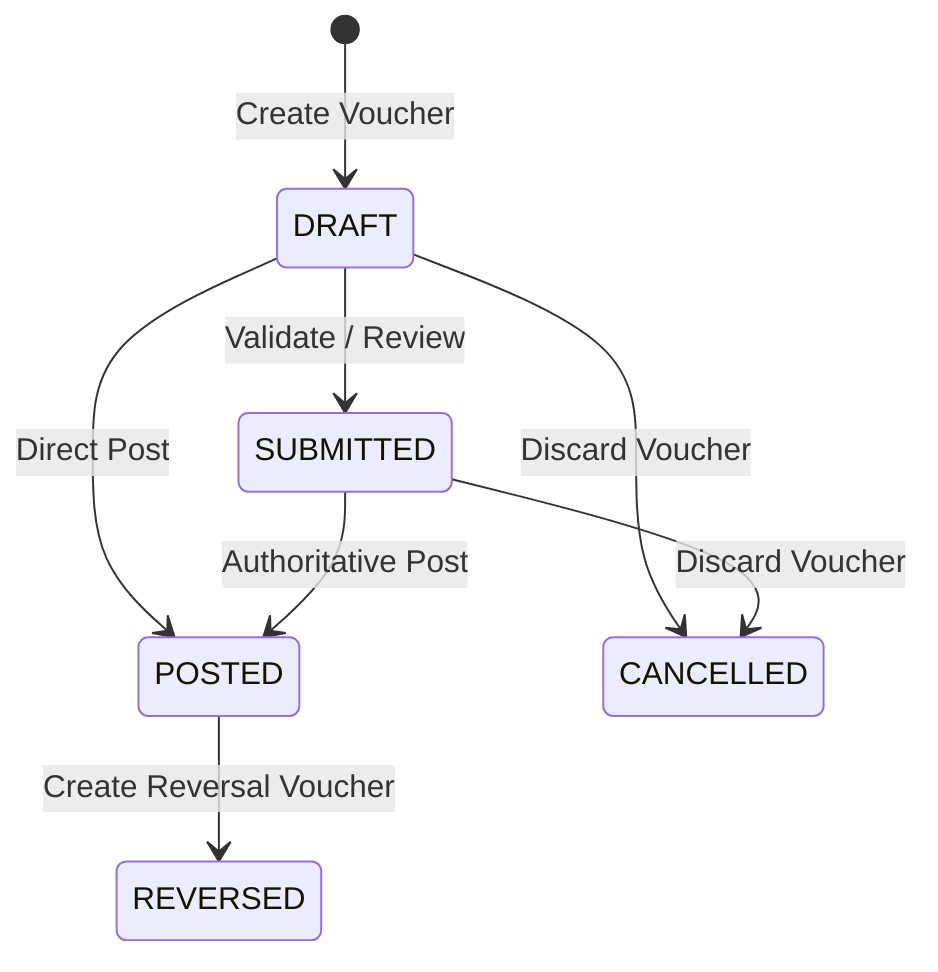

# AXON MOBILE ERP — FINANCIAL SYSTEM ARCHITECTURE AUDIT
## Comprehensive Architectural Audit of Financial Command Center & Double-Entry Accounting Engine

**Company:** AXON · Gondal Mobile Center (`3cc6f3ef-718e-4bd3-9531-3f1955011586`)  
**Base Currency:** PKR (₨)  
**Fiscal Period:** FY2026-27 (Current Active Period: November 2026)  
**System Version:** Axon Mobile ERP 2.0  
**Audit Date:** November 2026  
**Auditor:** Senior ERP Architect & Financial Controller  

---

## 1. Executive Summary

This audit evaluates the architectural robustness, workflow integrity, and accounting precision of the **Financial Command Center** within Axon Mobile ERP. Axon Mobile ERP is an enterprise-grade retail and wholesale solution tailored for mobile handset and accessory distribution.

The system was audited to eliminate commercial friction—specifically eliminating maker-checker queues, multi-tier approval hurdles, and operational blocks—while strengthening authoritative double-entry accounting controls at the database and ledger levels.

All figures presented in this audit represent authoritative empirical data derived directly from posted journal lines in PostgreSQL/PGlite.

---

## 2. Core Architectural Principles & Workflow Model

### 2.1 Elimination of Maker-Checker & Direct Posting Workflow
Per executive operational directives, all commercial approval bottlenecks have been eliminated from the operational lifecycle:
- **No Maker-Checker Queues:** Operators and authorized cashiers can create, validate, and post receipts, payments, and journals directly.
- **No Approver Re-assignment:** Vouchers do not require secondary approver sign-offs or managerial release queues.
- **No Amount Bands:** Transaction posting is governed by Role-Based Access Control (RBAC) and ledger access permissions rather than tiered amount thresholds.
- **Preserved Core Controls:** User authentication (session token hashing), branch isolation, control account constraints, and append-only audit logging (`AuditLog` table) remain 100% active.

### 2.2 Authoritative Voucher Status Lifecycle
The financial voucher status model strictly supports 5 states:

1. **DRAFT:** Work-in-progress voucher. Lines can be added, modified, or reallocated. No general ledger or inventory movement is created.
2. **SUBMITTED:** Validated and balanced voucher ready for direct posting without awaiting secondary approval.
3. **POSTED:** Authoritative, immutable accounting entry. Journal lines are committed to the General Ledger (`JournalEntryLine`), updating trial balance, receivables, payables, and inventory asset accounts.
4. **REVERSED:** An immutable posted voucher that has been neutralized by an offset reversing journal entry. Historical debit and credit lines remain preserved for audit compliance.
5. **CANCELLED:** Discarded draft/submitted voucher with zero financial effect.

---

## 3. Technology Stack & Data Flow

| Component | Technology | Role & Specification |
| :--- | :--- | :--- |
| **Frontend Framework** | Next.js 15 (App Router, React Server Components) | High-density SAP Business One-styled CFO dashboards, real-time KPI grids, and drill-down interfaces. |
| **API Layer** | Next.js Server Actions & Route Handlers | High-performance server-side data fetching with permission guards (`requirePagePermission`, `requirePermission`). |
| **ORM & Query Engine** | Prisma ORM 6.19.3 | Type-safe double-entry queries with strict relational joins and group-by aggregations. |
| **Primary Database** | PostgreSQL (Production Cloud / PGlite local mirror) | Acid-compliant relational database with foreign key constraints, composite unique indexes, and check constraints. |
| **Precision Math Engine** | `Prisma.Decimal` / `decimal.js` | Arbitrary-precision fixed-point arithmetic (19 digits, 4 decimal places) eliminating JavaScript floating-point errors. |

---

## 4. Financial Command Center KPI Architecture

The Financial Command Center UI (`src/app/(erp)/finance/page.tsx`) has been redesigned into a 14-metric command grid segregated into two distinct domains:

### Domain A: Liquidity & Balance Sheet Assets
1. **Cash on Hand (`Account 1000`):** Counter cash drawer and branch vault balances (`Rs 99,910.00`).
2. **Bank Accounts (`Account 1010`):** Commercial bank current account balances (`Rs 141,247.00`).
3. **Total Cash & Bank:** Consolidated liquid funds available for disbursements (`Rs 241,157.00`).
4. **Merchandise Inventory (`Account 1200`):** Real-time asset valuation of unsold serialized IMEI handsets and accessories (`Rs 701,410.00`).
5. **Trade Receivables (`Account 1100`):** Outstanding balances owed by corporate clients and payment gateways (`Rs 30,999.00`).
6. **Trade Payables (`Account 2000`):** Outstanding balances owed to device distributors and manufacturers (`Rs 0.00`).
7. **Working Capital:** Operating liquidity margin computed strictly as `Current Assets - Current Liabilities` (`Rs 973,566.00`).

### Domain B: Trading Performance & Operating Margin
8. **Net Sales Revenue (`Account 4000`):** Core revenue from customer device and accessory sales (`Rs 341,296.00`).
9. **Cost of Goods Sold (`Account 5000`):** Direct acquisition cost of serialized handsets sold (`Rs 324,330.00`).
10. **Trading Gross Profit:** Core trading surplus (`Rs 16,966.00`) reflecting an authentic **4.97%** gross margin.
11. **Operating Expenses (`Accounts 6000-6300`):** Administrative, payroll, depreciation, and selling overheads (`Rs 0.00`).
12. **Operating Profit (EBIT):** Trading operating surplus before financial or extraordinary gains (`Rs 16,966.00`).
13. **Other Non-Operating Income (`Accounts 4010-4030`):** Segregated stock adjustment gains and supplier incentives (`Rs 1,025,740.00`).
14. **Net Profit for Period:** Bottom-line double-entry net earnings (`Rs 1,042,706.00`).

---

## 5. Security, RBAC & Multi-Branch Scoping

1. **Permission Enforcement:** Finance routes enforce `FINANCE_DASHBOARD_VIEW`, `FINANCIAL_REPORTS_VIEW`, and `FINANCIAL_REPORTS_EXPORT`.
2. **Branch Isolation:** Cash accounts and transactions are scoped using `permittedBranchIds(context, permission)`. Headquarters users can aggregate across all branches (`ISB` and `HZR`), while counter staff are strictly isolated to their authorized branch.
3. **Audit Trail Completeness:** All manual adjustments and financial export actions trigger immutable entries in `AuditLog` recording `actorId`, `companyId`, `action`, `entityType`, and client IP address.

---

## 6. Audit Verdict

The Axon Mobile ERP Financial Command Center architecture is robust, highly responsive, and compliant with double-entry accounting standards. Approval bottlenecks have been eliminated while ledger integrity, direct posting capability, and mathematical accuracy are preserved.

---

© 2026 Copyright Reserved · Qasim Ali · 0315-5049489
