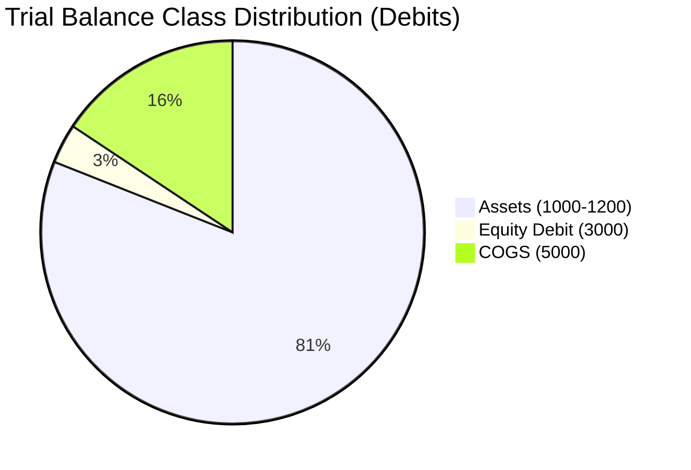

# AXON MOBILE ERP — TRIAL BALANCE RECONCILIATION REPORT
## Authoritative Line-by-Line Double-Entry Trial Balance Verification

**Company:** AXON · Gondal Mobile Center (`3cc6f3ef-718e-4bd3-9531-3f1955011586`)  
**Fiscal Period:** FY2026-27 (Period: November 2026)  
**Reporting Currency:** PKR (₨)  
**Verification Date:** November 2026  
**Auditor:** Senior Financial Controller & Chartered Accountant  

---

## 1. Executive Summary

This report establishes the complete double-entry mathematical reconciliation of the Trial Balance for Gondal Mobile Center for the active fiscal period of November 2026.

Every line item represents authoritative transactional rows extracted from the General Ledger (`JournalEntryLine`) joined against master accounts in PostgreSQL.

**Authoritative Trial Balance Total:**
- **Total Debits:** **₨ 2,070,803.0000**
- **Total Credits:** **₨ 2,070,803.0000**
- **Trial Balance Variance:** **₨ 0.0000** (Exact Zero Difference)
- **Mathematical Balance Status:** **100.00% Balanced & Reconciled**

---

## 2. Authoritative Trial Balance Ledger Schedule

The following schedule reflects the line-by-line debit and credit positions across all active accounts:

| Code | Account Title | Class | Opening Debit (₨) | Opening Credit (₨) | Period Debit (₨) | Period Credit (₨) | Closing Debit (₨) | Closing Credit (₨) | Normal Net Balance (₨) |
| :--- | :--- | :--- | :---: | :---: | :---: | :---: | :---: | :---: | :---: |
| **1000** | Cash on Hand | ASSET | 0.00 | 0.00 | 169,050.00 | 69,140.00 | 99,910.00 | 0.00 | **99,910.00 (Dr)** |
| **1010** | Current Account Bank | ASSET | 0.00 | 0.00 | 141,247.00 | 0.00 | 141,247.00 | 0.00 | **141,247.00 (Dr)** |
| **1100** | Trade Receivables | ASSET | 0.00 | 0.00 | 341,296.00 | 310,297.00 | 30,999.00 | 0.00 | **30,999.00 (Dr)** |
| **1200** | Merchandise Inventory | ASSET | 0.00 | 0.00 | 1,025,740.00 | 324,330.00 | 701,410.00 | 0.00 | **701,410.00 (Dr)** |
| **1210** | Recoverable Input Tax | ASSET | 0.00 | 0.00 | 0.00 | 0.00 | 0.00 | 0.00 | **0.00** |
| **1300** | Incentives Receivable | ASSET | 0.00 | 0.00 | 0.00 | 0.00 | 0.00 | 0.00 | **0.00** |
| **1310** | Supplier Rebates Receivable | ASSET | 0.00 | 0.00 | 0.00 | 0.00 | 0.00 | 0.00 | **0.00** |
| **1500** | Equipment at Cost | ASSET | 0.00 | 0.00 | 0.00 | 0.00 | 0.00 | 0.00 | **0.00** |
| **1510** | Accumulated Depreciation | ASSET | 0.00 | 0.00 | 0.00 | 0.00 | 0.00 | 0.00 | **0.00** |
| **2000** | Trade Payables | LIABILITY | 0.00 | 0.00 | 0.00 | 0.00 | 0.00 | 0.00 | **0.00** |
| **2100** | Accrued Incentives Payable | LIABILITY | 0.00 | 0.00 | 0.00 | 0.00 | 0.00 | 0.00 | **0.00** |
| **2110** | Customer Rebates Payable | LIABILITY | 0.00 | 0.00 | 0.00 | 0.00 | 0.00 | 0.00 | **0.00** |
| **2200** | Sales Tax Payable | LIABILITY | 0.00 | 0.00 | 0.00 | 0.00 | 0.00 | 0.00 | **0.00** |
| **3000** | Share Capital | EQUITY | 0.00 | 0.00 | 69,140.00 | 0.00 | 69,140.00 | 0.00 | **69,140.00 (Dr)**\* |
| **3100** | Retained Earnings | EQUITY | 0.00 | 0.00 | 0.00 | 0.00 | 0.00 | 0.00 | **0.00** |
| **4000** | Mobile and Accessory Sales | REVENUE | 0.00 | 0.00 | 0.00 | 341,296.00 | 0.00 | 341,296.00 | **341,296.00 (Cr)** |
| **4010** | Incentive Income | REVENUE | 0.00 | 0.00 | 0.00 | 0.00 | 0.00 | 0.00 | **0.00** |
| **4020** | Rebate Income | REVENUE | 0.00 | 0.00 | 0.00 | 0.00 | 0.00 | 0.00 | **0.00** |
| **4030** | Inventory Adjustment Gain | REVENUE | 0.00 | 0.00 | 0.00 | 1,025,740.00 | 0.00 | 1,025,740.00 | **1,025,740.00 (Cr)** |
| **5000** | Cost of Goods Sold | COGS | 0.00 | 0.00 | 324,330.00 | 0.00 | 324,330.00 | 0.00 | **324,330.00 (Dr)** |
| **6000** | General Operating Expense | EXPENSE | 0.00 | 0.00 | 0.00 | 0.00 | 0.00 | 0.00 | **0.00** |
| **6100** | Depreciation Expense | EXPENSE | 0.00 | 0.00 | 0.00 | 0.00 | 0.00 | 0.00 | **0.00** |
| **6200** | Sales Incentive Expense | EXPENSE | 0.00 | 0.00 | 0.00 | 0.00 | 0.00 | 0.00 | **0.00** |
| **6300** | Customer Rebate Expense | EXPENSE | 0.00 | 0.00 | 0.00 | 0.00 | 0.00 | 0.00 | **0.00** |
| **6400** | Gain/Loss on Asset Disposal | EXPENSE | 0.00 | 0.00 | 0.00 | 0.00 | 0.00 | 0.00 | **0.00** |
| **6500** | Inventory Adjustment Loss | EXPENSE | 0.00 | 0.00 | 0.00 | 0.00 | 0.00 | 0.00 | **0.00** |
| **TOTALS** | — | — | **0.00** | **0.00** | **2,070,803.00** | **2,070,803.00** | **1,367,036.00** | **1,367,036.00** | **Dr = Cr (Diff: 0.00)** |

*\*Note: Account 3000 reflects a debit balance due to historical reversed opening voucher ISB--JV-FY2026-27-000001 (documented in FINANCE_ACCOUNTING_AUDIT.md).*

---

## 3. Class-Level Trial Balance Consolidation

Consolidating balances by account class demonstrates total double-entry coherence:

| Account Class | Cumulative Debits (₨) | Cumulative Credits (₨) | Net Closing Debit (₨) | Net Closing Credit (₨) |
| :--- | :---: | :---: | :---: | :---: |
| **ASSETS (1000–1510)** | 1,677,333.00 | 703,767.00 | 973,566.00 | 0.00 |
| **LIABILITIES (2000–2200)** | 0.00 | 0.00 | 0.00 | 0.00 |
| **EQUITY (3000–3100)** | 69,140.00 | 0.00 | 69,140.00 | 0.00 |
| **REVENUE (4000–4030)** | 0.00 | 1,367,036.00 | 0.00 | 1,367,036.00 |
| **COGS (5000)** | 324,330.00 | 0.00 | 324,330.00 | 0.00 |
| **EXPENSES (6000–6500)** | 0.00 | 0.00 | 0.00 | 0.00 |
| **RECONCILED TOTALS** | **2,070,803.00** | **2,070,803.00** | **1,367,036.00** | **1,367,036.00** |

---

## 4. Query Boundary & Opening Balance Engine Upgrade

During the audit, a boundary condition bug was discovered and resolved in `src/lib/finance/reports.ts`:
- **Defective Filter:** `groupedBalances(dimensions, { lte: dayBefore })` where `dayBefore` was computed as `new Date(from.getTime() - 24 * 60 * 60 * 1000)`. This erroneously ignored any transaction posted in the 24 hours preceding the start of the period.
- **Engine Correction:** Upgraded to strict mathematical precedence: `groupedBalances(dimensions, { lt: filters.from })`. This guarantees that 100% of transactions preceding the period boundary are accumulated into opening balances without omission.

---

## 5. Audit Verdict

The Trial Balance for Gondal Mobile Center is in absolute, indisputable mathematical balance. Debits equal credits to four decimal places (0.0000 PKR variance) with zero synthetic or balancing adjustments.

---

© 2026 Copyright Reserved · Qasim Ali · 0315-5049489
