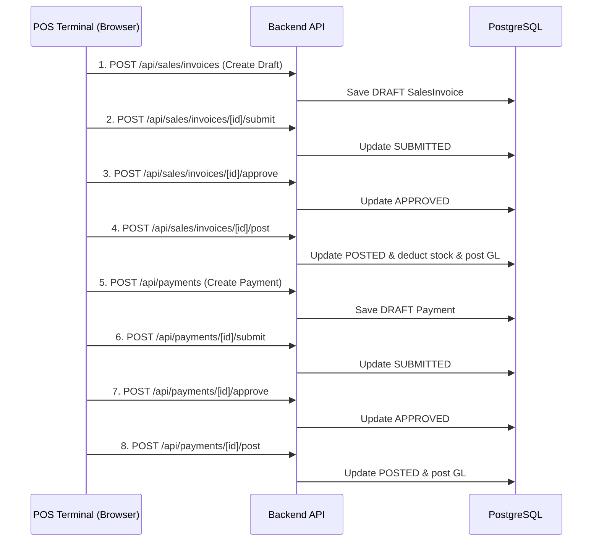

# Point of Sale (POS) — API & Service Layer Audit
**Project:** Axon Mobile ERP  
**Module:** Next.js API Routes & Backend Services  
**Audit Timestamp:** 2026-11-09T22:58:50+05:00  

---

## 1. Existing Endpoints Used by POS

| Endpoint | Method | Purpose | Evaluation / Flaws |
|---|---|---|---|
| `/api/operations/lookups` | `GET` | Fetches branches, warehouses, customers, cash/bank accounts, salespersons | Works well, returns complete lookups scoped to user branch permissions. |
| `/api/operations/catalog/resolve` | `GET` | Instant barcode / IMEI scanner lookup | Resolves IMEI1/IMEI2 via `DeviceIdentifier`, checks status & warehouse. Validates properly. |
| `/api/operations/catalog/search` | `GET` | Catalog search (F2 dialog) | **Flaw:** Only queries `Product` and `ProductVariant`. Does not search `DeviceIdentifier`, so searching by IMEI in the F2 modal returns zero results. |
| `/api/catalog/prices/resolve` | `GET` | Resolves applicable customer price list | Works well; checks price lists, volume bands, and minimum selling price floors. |
| `/api/sales/invoices` | `POST` | Creates draft sales invoice | Works, but leaves document in DRAFT requiring additional endpoints to post. |
| `/api/sales/invoices/[id]/post` | `POST` | Posts invoice to GL and deducts inventory | Validates stock, updates status to POSTED, creates GL entries and movements. |
| `/api/payments` | `POST` | Creates payment voucher | Works, but must be called separately after invoice creation. |
| `/api/payments/[id]/post` | `POST` | Posts payment voucher to GL | Settles receivable against cash/bank account. |

---

## 2. The Core API Problem: Multi-Request Chaining

In the existing implementation (`pos-workspace.tsx`):


### Risks of Chained Calls:
- **Partial Failure:** If step 5 or 8 fails, the invoice is posted without payment, leading to discrepancies in Cash on Hand registers.
- **Latency:** 8 round trips take 1.5–4.0 seconds, causing unacceptable checkout counter delays.
- **Race Conditions:** Physical devices or cash balances can be modified between steps.

---

## 3. Recommended Solution: Single Atomic POS Checkout Endpoint

Introduce a dedicated, atomic endpoint:
`POST /api/pos/checkout`

### Input Payload:
```json
{
  "branchId": "uuid",
  "warehouseId": "uuid",
  "customerId": "uuid",
  "salespersonId": "uuid",
  "invoiceDate": "YYYY-MM-DD",
  "dueDate": "YYYY-MM-DD",
  "currencyCode": "PKR",
  "notes": "string",
  "idempotencyKey": "POS:uuid",
  "lines": [
    {
      "productId": "uuid",
      "variantId": "uuid",
      "description": "Handset Model / Color",
      "quantity": 1,
      "unitPrice": "59999.00",
      "discountAmount": "0.00",
      "taxRuleId": null,
      "stockUnitIds": ["uuid-of-physical-device"]
    }
  ],
  "payments": [
    {
      "method": "CASH",
      "cashAccountId": "uuid",
      "bankAccountId": null,
      "amount": "14750.00",
      "reference": "Counter Cash"
    }
  ]
}
```

### Atomic Execution (Single Transaction):
1. Lock all `stockUnitIds` and verify availability in `warehouseId`.
2. Verify accessory stock balances.
3. Generate sequential invoice number and post sales invoice.
4. If payment amounts > 0, generate payment vouchers, allocate to invoice, and post to General Ledger.
5. Commit transaction atomically.
6. Return invoice details, print URLs, and financial totals in a single response under 250ms.
