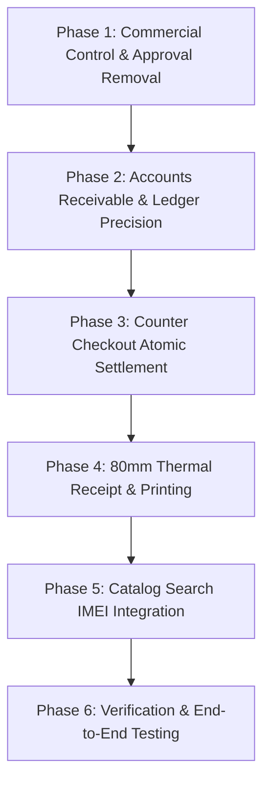

# AXON MOBILE ERP — POS ENHANCEMENT & STABILIZATION PLAN
## Step-by-Step Architecture Roadmap

**Date:** November 2026  
**Module:** Point of Sale (POS) & Counter Terminal  

---

## 1. Roadmap Overview

---

## 2. Phase Breakdown

### Phase 1: Commercial Control & Approval Removal
- Remove top-bar Operating Mode switch (Single-User vs Multi-User).
- Remove Commercial Controls and Approval Band policy screens.
- Remove maker-checker gatekeepers in sales, payments, and settlements.
- Direct 1-click posting enabled for all authorized users under standard RBAC.

### Phase 2: Accounts Receivable & Ledger Precision
- Exclude DRAFT, SUBMITTED, and APPROVED invoices from Accounts Receivable summaries.
- Ensure only `POSTED` sales invoices write to GL journals and customer ledgers.
- Investigate and resolve historical unposted invoices (e.g., Palmpay invoice `000004`).

### Phase 3: Counter Checkout Atomic Settlement
- Wire POS counter tender modes (`cash`, `card`, `wallet`) to generate and post matching `CUSTOMER_RECEIPT` payment vouchers automatically.
- Ensure cash account (or bank account) is debited immediately upon counter checkout.
- For credit sales with down payment, record advance receipt and stamp remaining balance on invoice.

### Phase 4: 80mm Thermal Receipt & Printing
- Create `/sales/[id]/receipt` route.
- Implement 80mm printer styling, Code 128 barcode, device identifiers, and payment breakdown.
- Add print shortcuts to POS checkout completion card.

### Phase 5: Catalog Search IMEI Integration
- Enhance `/api/operations/catalog/search` to query `DeviceIdentifier` for partial or exact IMEI1/IMEI2.
- Support instant product discovery in F2 search modal.

### Phase 6: Verification & End-to-End Testing
- Validate TypeScript compilation across all solution projects.
- Run unit and integration tests.
- Verify production deployment compatibility with Neon PostgreSQL.
